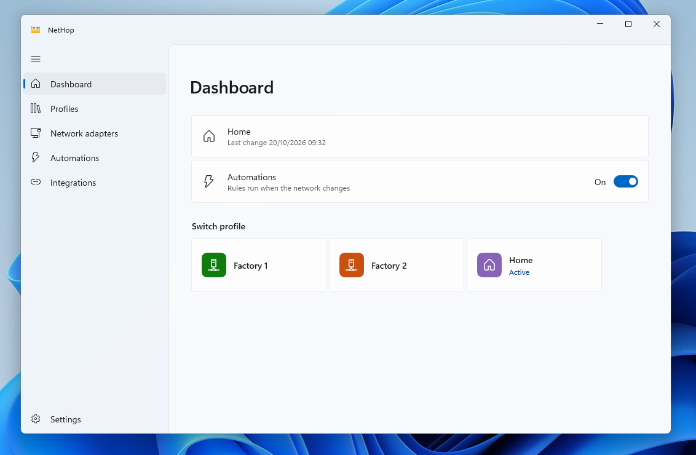
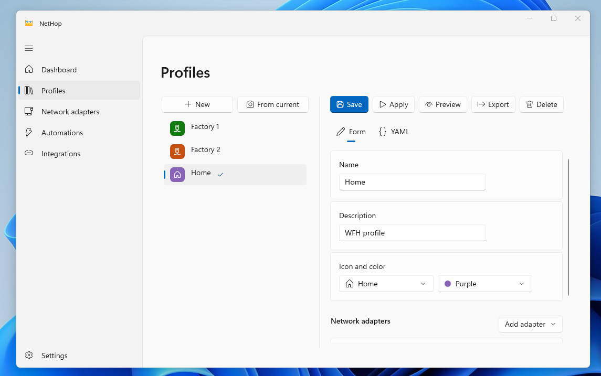
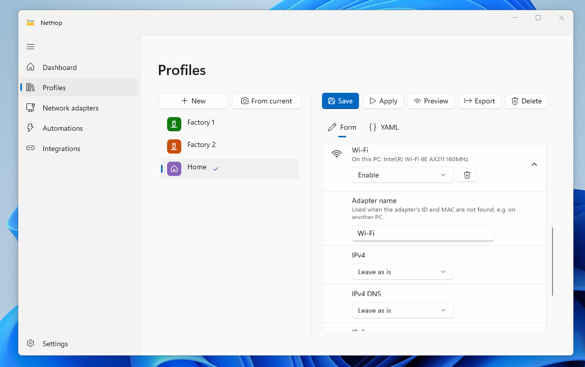
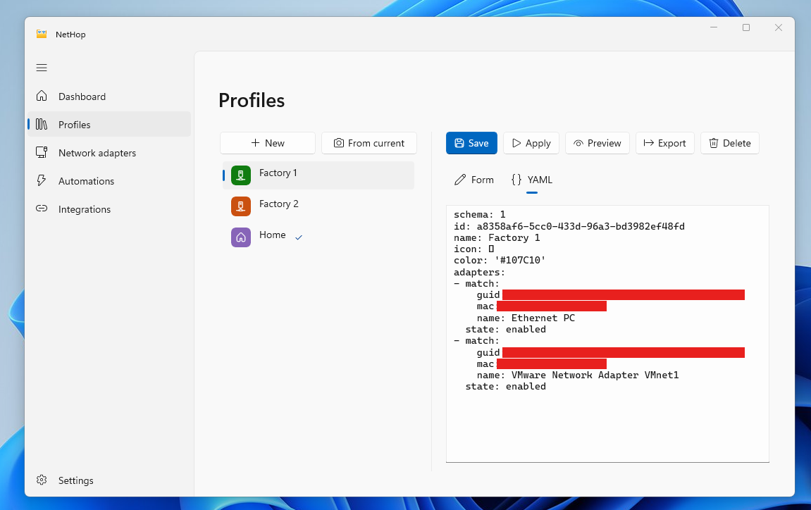
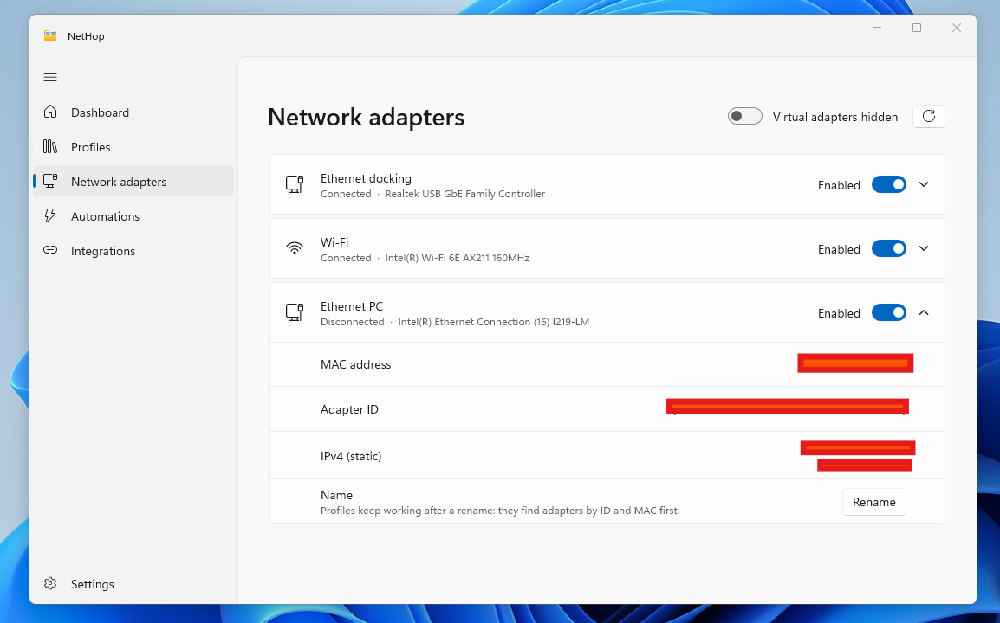
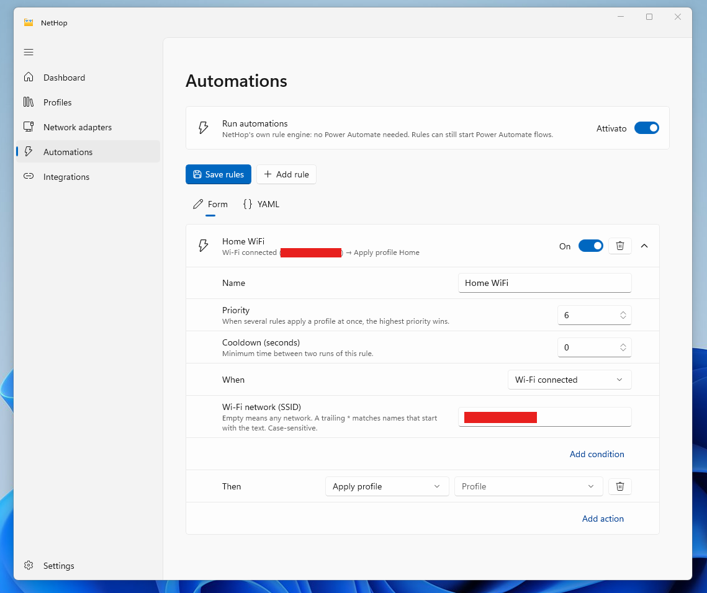
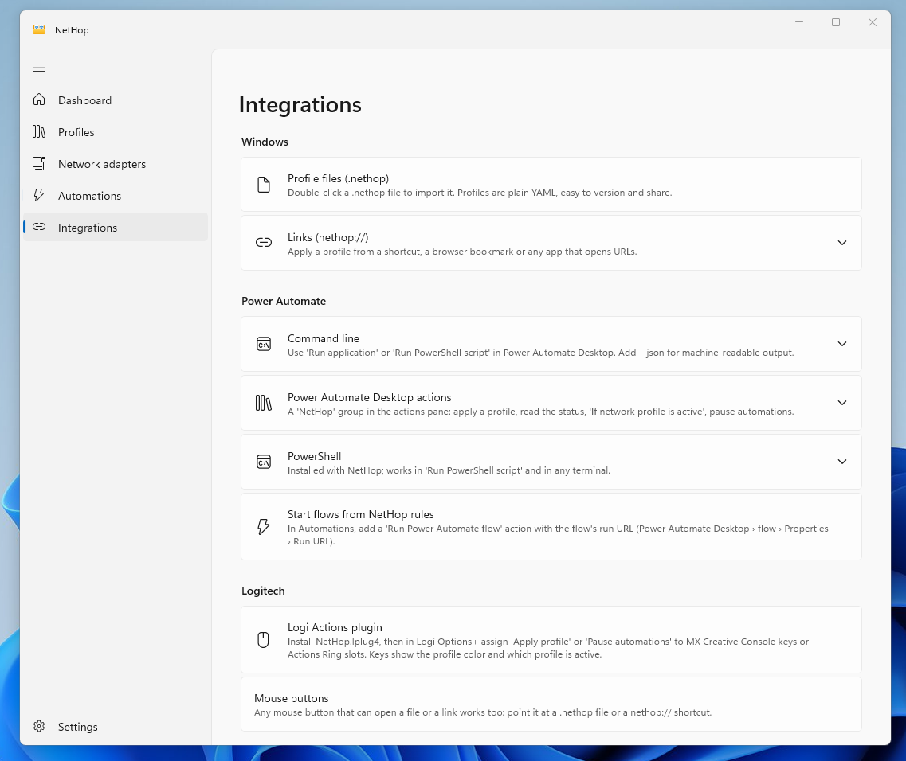

<p align="center">
  
</p>

<h1 align="center">NetHop</h1>

**Hop between network configurations in one click.** NetHop is an open-source network profile switcher for Windows 11, in the spirit of NetSetMan, with a PowerToys-style Fluent UI.

> Status: preview (v0.3). Builds are not code-signed yet: see [Releases](https://github.com/agateeno/net-hop/releases).

## Install

With [winget](https://learn.microsoft.com/windows/package-manager/winget/), from a terminal:

```powershell
winget install agateeno.NetHop
```

Update it later with `winget upgrade agateeno.NetHop`. NetHop is being added to winget: until `winget search agateeno.NetHop` finds it, use the installer below.

Or download the MSI for your PC (`x64`, or `arm64` for Windows on Arm) from [Releases](https://github.com/agateeno/net-hop/releases/latest) and run it. Windows asks for administrator rights, because NetHop installs a service. Builds are not signed yet, so SmartScreen may warn: choose **More info › Run anyway**.

## Screenshots

<p align="center">
  
</p>

<table>
  <tr>
    <td align="center"><br><sub>Profile editor: name, icon and color</sub></td>
    <td align="center"><br><sub>Per-adapter settings: state, IPv4, IPv6, DNS</sub></td>
  </tr>
  <tr>
    <td align="center"><br><sub>The same profile as YAML (<code>.nethop</code>)</sub></td>
    <td align="center"><br><sub>Network adapters: enable, inspect, rename</sub></td>
  </tr>
  <tr>
    <td align="center"><br><sub>Automations: when, only if, then</sub></td>
    <td align="center"><br><sub>Integrations: CLI, Power Automate, PowerShell, Logitech</sub></td>
  </tr>
</table>

## Features

- **Profiles** enable/disable adapters and set IPv4 **and** IPv6: DHCP or static, with multiple addresses, gateways and DNS servers.
- **Minimal changes**: NetHop compares the profile with the live configuration and only changes what differs. A failed step rolls back the adapters it touched.
- **Plain files**: profiles are YAML documents with the `.nethop` extension. Double-click one to import it.
- **Profile editor** with a form view and a YAML view: start from scratch, from the current configuration, or by duplicating a profile.
- **Tray flyout**: left-click the notification-area icon to see the active profile and switch with one click.
- **Built-in automations**: rules such as "when I join the Wi-Fi `CORP-WiFi` on a weekday, apply *Office*", with no extra software. Loop protection, cooldowns and a pause switch are included.
- **Power Automate**: a *NetHop* group of custom actions in Power Automate Desktop, a PowerShell module, and a CLI with JSON output. NetHop rules can also start flows.
- **Logitech**: a Logi Actions plugin for the MX Creative Console and the Actions Ring, with keys that show the active profile.
- **Installer**: per-machine MSIs for x64 and ARM64 with the service, `PATH`, file types, an "Apply with NetHop" context menu entry and a Start menu entry. Releases also produce winget manifests.
- **Update check**: Settings shows when a newer release is out (stable releases, and optionally pre-releases), and a notification says so once per version. NetHop only asks GitHub for the list of releases: nothing is sent about your PC, and nothing is downloaded or installed for you. It can be turned off in Settings.
- **Six languages**: English, Deutsch, Español, Français, Italiano and Português (Brasil). The app follows the Windows display language, or the one picked in Settings.
- **Rename adapters** without breaking profiles: profiles find adapters by GUID, then MAC, then name.

## Architecture

```
┌───────────────────────────┐   named pipe + JSON-RPC   ┌─────────────────────────────┐
│ NetHop.App (WinUI 3)      │ ◄───────────────────────► │ NetHop.Service (SYSTEM)     │
│ settings · tray · flyout  │                           │ profile store · rule engine │
├───────────────────────────┤                           │ network monitor             │
│ nethop.exe (CLI)          │ ◄───────────────────────► │ NetHop.Engine (CIM, Win32)  │
│ Logi plugin · PA actions  │                           └─────────────────────────────┘
└───────────────────────────┘
```

Changing IP settings needs administrator rights, so all changes are made by a Windows service and the UI never asks for elevation. Only **administrator accounts** can make changes; other accounts can open NetHop read-only, with a button to restart it as administrator. See [docs/architecture.md](docs/architecture.md).

| Project | Target | Role |
|---|---|---|
| `NetHop.Core` | net10.0 | Profile/rule models, YAML, validation, planner, rule engine. Pure logic, fully unit-tested |
| `NetHop.Ipc` | net10.0 | The service contract (`INetHopService`) and the pipe client |
| `NetHop.Engine` | net10.0, Windows | Reads and changes the network through CIM (`root\StandardCimv2`), iphlpapi and wlanapi |
| `NetHop.Service` | net10.0, Windows | Windows service hosting everything above |
| `NetHop.Cli` | net10.0 | `nethop.exe` |
| `NetHop.App` | net10.0-windows10.0.22621 | WinUI 3 app (Windows App SDK 2.5) |
| `NetHop.PowerAutomate` | net472 | Power Automate Desktop custom actions (`Modules.NetHop.dll`) |
| `NetHop.PowerShell` | PowerShell 5.1+ | `NetHop` module |
| `NetHop.LogiPlugin` | net8.0 | Logi Actions plugin. Builds only where Logi Options+ is installed |
| `installer/` | WiX 6 | MSI |

Integrations: [docs/integrations.md](docs/integrations.md). Installer: [docs/installer.md](docs/installer.md).

## Profile format


Profiles are `.nethop` files. Double-click one to open it in NetHop, or right-click it and choose **Apply with NetHop**.

```yaml
schema: 1
name: Office
adapters:
  - match: { name: Ethernet, mac: 00-1A-2B-3C-4D-5E }
    state: enabled
    ipv4:
      mode: static
      addresses: [192.168.10.50/24, 10.20.0.5/16]
      gateways: [192.168.10.1]
      dns: { mode: static, servers: [192.168.10.1, 1.1.1.1] }
    ipv6:
      mode: dhcp
  - match: { name: Wi-Fi }
    state: disabled
```

Full reference: [docs/profile-format.md](docs/profile-format.md). More examples are in [samples/](samples/).

## Command line

```
nethop list                      nethop apply Office [--dry-run]
nethop status [--json]           nethop export Office out.nethop
nethop adapters                  nethop rename "Ethernet 2" "Dock"
nethop enable|disable <adapter>  nethop import Office.nethop
nethop validate Office.nethop    nethop pause 60 | resume
nethop nethop://apply/Office
```

Exit codes: `0` ok, `1` failed, `2` usage error, `3` service not running, `4` access denied.

## Building

Requirements: .NET 10 SDK. The WinUI app builds only on Windows (Visual Studio 2022 17.14+ or the .NET CLI); everything else also builds on macOS and Linux.

```powershell
dotnet build NetHop.slnx
dotnet test tests/NetHop.Core.Tests
```

The app icon is drawn in SVG under [assets/icon](assets/icon): `NetHop.svg` (large sizes), `NetHop-small.svg` (20–32 px) and `NetHop-16.svg` (16 px). While NetHop is in preview, the "PRE" badge (`PreBadge*.svg`) is drawn over it (`PREVIEW` in `build_icons.py`). After editing one, run `python assets/icon/build_icons.py` (needs [resvg](https://github.com/linebender/resvg)) to regenerate the `.ico` and `.png` files.

Every push builds on GitHub Actions and produces **NetHop-msi** (x64 and ARM64 installers), **NetHop-win-x64** / **NetHop-win-arm64** (the same binaries as folders) and the Power Automate module (unsigned unless signing is configured, see [docs/installer.md](docs/installer.md#code-signing)). Install the MSI, or, for a quick test without it, extract the folder and run from an elevated PowerShell:

```powershell
.\Install-NetHop.ps1      # copies to Program Files, registers and starts the service
.\Uninstall-NetHop.ps1    # removes it (add -RemoveData to delete profiles and rules)
```

## Roadmap

- [x] Profile model (IPv4 + IPv6), YAML, validation, diff planner, rollback
- [x] Rule engine with loop protection; network change detection
- [x] Windows service, named pipe (admins change, others read), CLI
- [ ] Verify the CIM backend on real hardware (see the spike list in [docs/architecture.md](docs/architecture.md#open-questions-spikes))
- [x] WinUI scaffold: dashboard, YAML editors, adapters page, tray flyout
- [x] Form-based profile and rule editors (with a YAML view kept in sync)
- [x] Installer (WiX) with service, PATH, file types and Start menu
- [x] Logi Actions SDK plugin (to verify with real hardware)
- [x] Power Automate Desktop custom actions and PowerShell module
- [x] ARM64 MSI, "Apply with NetHop" context menu, GitHub releases and winget manifests
- [x] Code signing in CI (Azure Trusted Signing, active once the secrets are set)
- [x] Localization: English, German, Spanish, French, Italian, Portuguese (Brazil)
- [x] Modern Windows 11 context menu entry (sparse package; shown on every machine once releases are signed)
- [x] Update check against GitHub releases (download and install once releases are signed)
- [ ] Verify everything on real hardware (spikes in docs/architecture.md)

## Code signing policy

Free code signing provided by [SignPath.io](https://about.signpath.io/), certificate by [SignPath Foundation](https://signpath.org/).

> **Status: application pending.** NetHop has applied to SignPath Foundation's open-source program. Until it is accepted, releases are not signed yet.

- Only files built from this repository's source by its GitHub Actions workflow are signed.
- Committers and reviewers: [agateeno](https://github.com/agateeno). Approver: [agateeno](https://github.com/agateeno) approves every signing request by hand.

## Privacy

NetHop sends no telemetry and collects no personal data. It connects to the internet only:

- to check for updates: a request to `api.github.com` for the list of NetHop releases, carrying only NetHop's version. It can be turned off in Settings › Updates;
- when you ask it to: a link you open, or a rule you wrote that opens a web page or starts a Power Automate flow.

Everything else (profiles, rules, network settings) stays on your PC. Full policy: [PRIVACY.md](PRIVACY.md).

## Security

To report a vulnerability, please do not open a public issue: see [SECURITY.md](SECURITY.md). The security model is described in [docs/architecture.md](docs/architecture.md#security-model).

## Acknowledgements

Thanks to [NetSetMan](https://www.netsetman.com/) by Ilja Herlein, which has made switching network settings on Windows easy for many years and inspired NetHop's profile-based approach. NetHop is an independent project: it is not affiliated with or endorsed by NetSetMan, and it shares no code with it. If you need a mature, feature-rich tool, give NetSetMan a try.

Thanks to [SignPath.io](https://about.signpath.io/) and [SignPath Foundation](https://signpath.org/), whose free code signing for open-source projects NetHop has applied for (request pending).

## Third-party software

NetHop is built on these libraries. Thanks to their authors.

**Included in NetHop**

| Component | Used for | License |
|---|---|---|
| [.NET](https://github.com/dotnet/runtime) and [Microsoft.Extensions.Hosting](https://www.nuget.org/packages/Microsoft.Extensions.Hosting) | Runtime (bundled, self-contained), Windows service host | MIT |
| [Windows App SDK](https://github.com/microsoft/WindowsAppSDK) (WinUI 3) | The app's user interface | [Microsoft license terms](https://www.nuget.org/packages/Microsoft.WindowsAppSDK) (redistributable) |
| [Windows Community Toolkit](https://github.com/CommunityToolkit/Windows) (Settings controls) and [MVVM Toolkit](https://github.com/CommunityToolkit/dotnet) | Settings cards, view models | MIT |
| [H.NotifyIcon](https://github.com/HavenDV/H.NotifyIcon) | Notification area icon and flyout | MIT |
| [YamlDotNet](https://github.com/aaubry/YamlDotNet) | Reading and writing `.nethop` profiles | MIT |
| [StreamJsonRpc](https://github.com/microsoft/vs-streamjsonrpc) and its dependencies | JSON-RPC between the service and its clients | MIT |
| [Microsoft.Management.Infrastructure](https://www.nuget.org/packages/Microsoft.Management.Infrastructure) | Reading and changing network settings through CIM | MIT |
| [Power Automate Desktop Actions SDK](https://www.nuget.org/packages/Microsoft.PowerPlatform.PowerAutomate.Desktop.Actions.SDK) | Power Automate custom actions | [Microsoft license terms](https://www.nuget.org/packages/Microsoft.PowerPlatform.PowerAutomate.Desktop.Actions.SDK) |
| [WiX Toolset](https://github.com/wixtoolset/wix) 6 (UI and Util extensions) | The MSI installer and its dialogs | MS-RL |
| [Open Sans](https://github.com/googlefonts/opensans) | Letters of the "PRE" badge in the icon, converted to outlines | SIL Open Font License 1.1 |

**Used, not included**

- [Logi Actions SDK](https://logitech.github.io/actions-sdk-docs/): the Logi plugin runs against `PluginApi.dll` from Logi Options+, which NetHop does not redistribute.
- Build and test only: [xUnit](https://github.com/xunit/xunit) (Apache 2.0), [coverlet](https://github.com/coverlet-coverage/coverlet) and the .NET test SDK (MIT), [resvg](https://github.com/linebender/resvg) for rendering the icons (Apache 2.0 or MIT).

Each component remains under its own license; the links lead to the full terms.

## License

[MIT](LICENSE)
